# Every app in the dock

The dock has 11 apps, in this order. Each has two icons: **Pixel** (the default) and **Classic**, switchable in Settings → Appearance.

| | Pixel | Classic | Name | id | Window file |
|---|---|---|---|---|---|
| 1 | 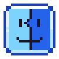 |  | Portfolio | `finder` | `windows/Finder.jsx` |
| 2 | 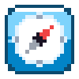 |  | Browser | `safari` | `windows/Safari.jsx` |
| 3 | 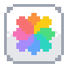 |  | Gallery | `photos` | `windows/Photos.jsx` |
| 4 |  |  | Contact | `contact` | `windows/Contact.jsx` |
| 5 | 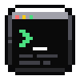 |  | Skills | `terminal` | `windows/Terminal.jsx` |
| 6 | 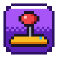 | 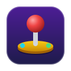 | Arcade | `arcade` | `windows/Arcade.jsx` |
| 7 | 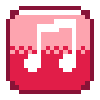 | 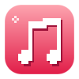 | Music | `music` | `windows/Music.jsx` |
| 8 |  |  | Pixie | `pixie` | `windows/PixieApp.jsx`, `windows/CastPanes.jsx` |
| 9 | 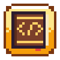 |  | Gourav's Book | `book` | `windows/Book.jsx` |
| 10 | 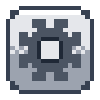 | 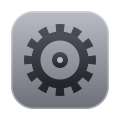 | Settings | `settings` | `windows/Settings.jsx` |
| 11 |  |  | Archive | `trash` | opens Portfolio at its Trash folder |

Names and icons are set in `dockApps` in `src/constants/indax.js`. The pixel icons are drawn in code by `scripts/pixel-icons.mjs`. To add your own app, see [Add an app to the dock](ADD-A-DOCK-APP.md).

## 1. Portfolio

A Finder for my work.

- A sidebar of places: **Projects**, **Work**, **About me**, **Resume** and **Trash**.
- Folders open with a click.
- Files open in their own window: text in **Text**, pictures in **Image**, and the résumé PDF in **Resume** (`react-pdf`).
- Search across every file and folder, showing where each one lives.

## 2. Browser

A browser that really browses.

- An address bar that takes a web address or a search.
- Back, forward, reload, and a start page of favourite sites with their icons.
- Sites load inside the window. Before showing a new site, the server checks whether it allows being framed (`server/frameCheck.js`).
- Sites that refuse get a friendly page with **Open in a new tab**, or the **cloud browser**: a real Chrome streamed from Hyperbeam that opens anything (`windows/CloudBrowser.jsx`, needs a key).

## 3. Gallery

Photos, laid out like the Photos app.

- A sidebar: Library, Memories, Places, People and Favorites.
- A grid of pictures. Clicking one opens it in the Image window.

## 4. Contact

How to reach me: a photo, an email address, and links to GitHub, the platform, Twitter/X and LinkedIn.

## 5. Skills

A working terminal.

- `help` lists the commands: `about`, `skills`, `projects`, `ls`, `contact`, `open`, `theme`, `pixie`, `whoami`, `date`, `echo`, `clear`, `exit`, and a joke for `sudo`.
- `open` launches any app by name, for example `open music` or `open browser`.
- `theme light`, `theme dark` or `theme system` switches the look.
- Earlier commands come back with the up and down arrow keys.

The commands live in `windows/terminalCommands.js`, so adding one is a few lines.

## 6. Arcade

Pac-Man, run in a frame from `public/games/pacman` so its keys and styles don't clash with the site.

- The keyboard goes straight to the game. On phones it has on-screen buttons.
- It pauses while minimized to the dock, and closing the window ends the game and its sound.

## 7. Music

Five chiptune songs made by the site itself: no audio files, just notes played with the Web Audio API.

- **Pixel Sunrise**, **Coffee & Code**, **Neel's Song**, **Half a Heart** and **Through the Portal**.
- Play, pause, next, previous, shuffle, repeat (off, all songs, this song), volume, and a bar to jump within a song.
- A pixel visualizer that moves with the music.
- A control in the menu bar, so music keeps playing with the window closed.
- The companions dance for the whole song, in a different style for each song.

## 8. Pixie

The app of the visitor's companion. Its pages change with who they picked:

- **Pixie:** **Now** (what she's doing, her energy and boredom), **Diary** (what her AI mind decided) and **Options**.
- **Gourav** or **someone special:** **Now** (what they're up to and their latest thoughts), **Today** (their day in numbers, such as coffees, thoughts and visits) and **Options**.
- A live portrait copies what they're doing on the desktop, and waves when you point at it.
- Options: show or hide the companion, their tips and thoughts, their things on the desktop, and whether Pixie decides for herself.

How the companions work: [The companions](COMPANIONS.md).

## 9. Gourav's Book

The book Gourav gives Pixie in her story: "everything about me".

- A pixel-art book whose pages turn in little steps, like an old game.
- Click the right page to go forward and the left page to go back, or use the arrow keys.
- The words come from `constants/about.js`, and the project and skill pages from the same lists as Portfolio and Skills.
- It also opens when you click Gourav's bookshelf.

## 10. Settings

Like System Settings, with five panes:

- **Appearance:** light, dark or auto; the text style; the icon style (Pixel or Classic).
- **Wallpaper:** the desktop picture.
- **Dock:** size, auto-hide, dots under open apps, and the minimize effect (genie, scale, fade or flip).
- **Sound:** sound effects, their volume, and the start-up sound.
- **About:** details about the portfolio.

Everything is saved in the browser, so it's the same on the next visit.

## 11. Archive

The Trash. It opens Portfolio at the **Trash** folder, which holds old work.

## What every app gets

- Dragging by the title bar, and a click brings it to the front.
- Red, yellow and green buttons: close, minimize into the dock, maximize.
- Opening out of its dock icon with the chosen effect.
- A dot under its dock icon while open.
- Found by Spotlight (⌘ or Ctrl + Space, or + K).
- A remark from the companion when it opens.
- On phones: an icon on the home screen, and it opens full screen.
